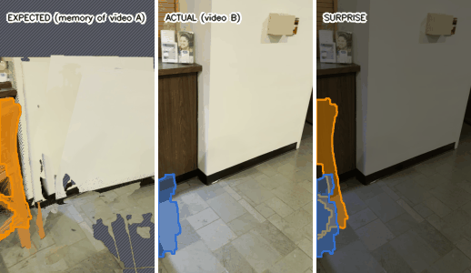
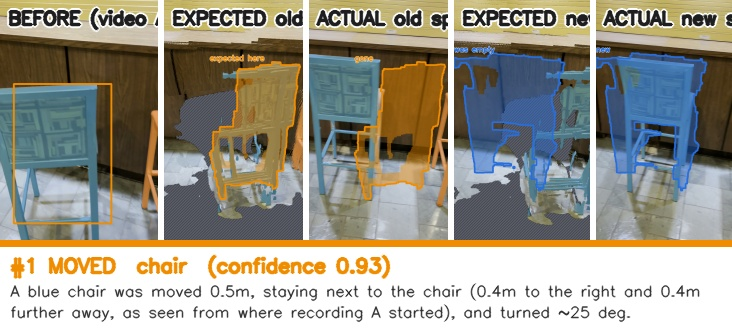
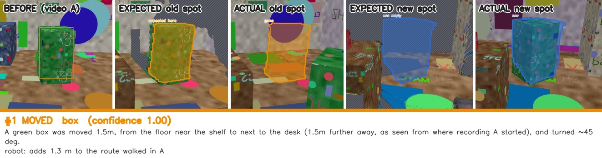
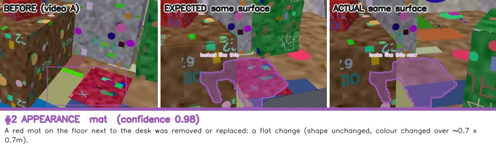
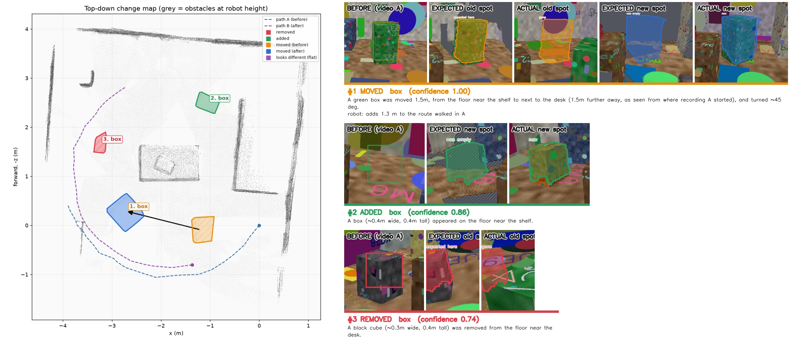
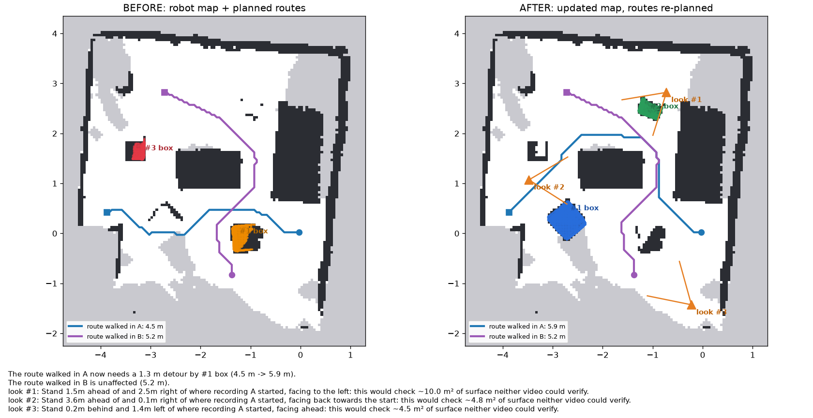
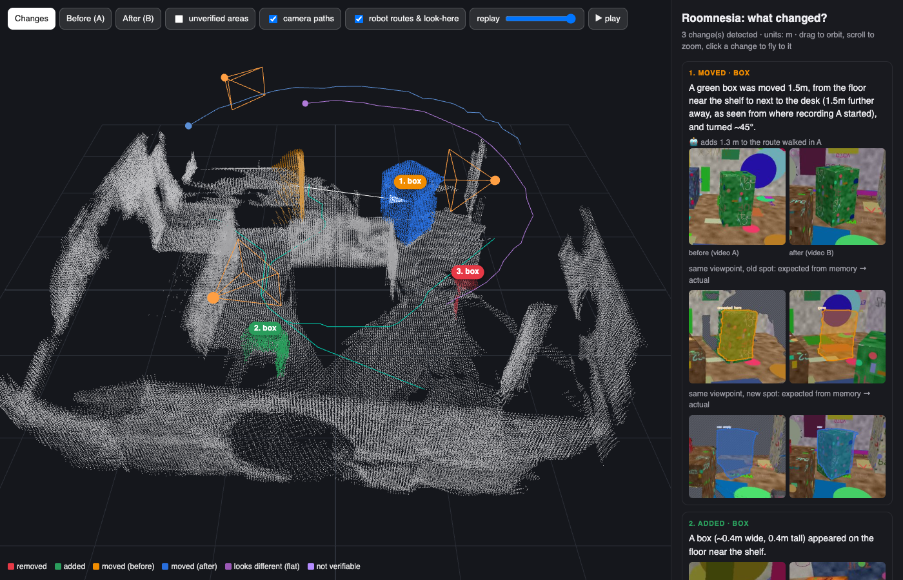

# Roomnesia: what changed in the room, and what it means for a robot

[](https://github.com/neevmodh/Roomnesia/actions/workflows/tests.yml)
**[▶ Live 3D demo](https://neevmodh.github.io/Roomnesia/)** (no install) · [real-world benchmark](#real-world-benchmark-scenediff) · [how it works](#how-it-works)

*Room + amnesia: a robot's memory of a room goes out of date the moment someone moves a chair. Roomnesia works out exactly what changed, proves each change from the camera's own viewpoint, and says what it means for navigation.*



*A real office from the [SceneDiff](https://huggingface.co/datasets/yuqun/SceneDiff) benchmark: two chairs and a stool were moved between the videos. Left, what each camera of the second video* should *see if nothing had changed (the first video re-rendered from that exact viewpoint; hatched = never seen). Middle, what it* did *see. Right, the detected changes. All 3 found, 0 false reports.*

Give it two phone videos of the same room, one before and one after. It builds one shared 3D model of both recordings, then reports:
1. **What changed:** objects that were moved, added or removed, plus flat things such as a rug or a poster whose *look* changed while their shape didn't. Each comes with 3D position, size, label and a plain-English sentence.
2. **Proof you can check at a glance:** for every change, the room as remembered from the before video is re-rendered from the exact viewpoint of an after-video camera and shown next to what that camera saw. Same viewpoint, so the difference *is* the change.
3. **What it can't tell:** places the other video never saw, or saw only through an obstacle, are reported as *unverifiable*, never as changes. Each run also measures its own depth noise, colour noise and false-alarm rate.
4. **What it means for a robot:** an updated occupancy map (ROS format), the walked routes re-planned before and after (*"the route is now blocked by the moved chair"*), and **where to stand and look next** to check the areas nobody could verify.

Everything runs locally on a **16 GB MacBook (Apple M4)**: no CUDA, no cloud, no API keys. A full run takes about 2–4 minutes.

**Tested on real data:** on 21 held-out real video pairs from a published benchmark, Roomnesia finds **90% of the furniture-scale changes** (chairs, bags, bins, boxes, stools), with 65% precision overall. Small tabletop items (pens, remotes, cups) are below its resolution, and the numbers say so ([details](#real-world-benchmark-scenediff)).

| The brief asks for | Where it is |
|---|---|
| A shared 3D representation of both recordings | both videos reconstructed **jointly** in one VGGT pass, in one gravity-aligned, wall-aligned metric frame ([§1](#1-one-shared-3d-scene-no-registration-step)) |
| Moved / added / removed objects, visualised in 3D | `viewer.html` (interactive three.js), `orbit.gif`, `topdown.png`, before/after cards ([§5](#outputs)) |
| Semantic labels / natural language | SigLIP + Grounding DINO labels, SmolVLM2 noun phrases, sentences built from measured geometry and relations to unchanged furniture ([§4](#4-semantics-that-agree-with-the-geometry)) |
| Real changes vs. viewpoint, occlusion, incomplete observations | per-ray **free-space evidence** witnessed by ≥ 4 cameras, a tolerance set by a built-in null test, and "unverifiable" instead of guesses ([§2–3](#2-change--free-space-evidence-not-point-distances)) |
| Quality of spatial change detection | **real-world benchmark**: 21 held-out SceneDiff pairs, plus a synthetic benchmark with ground truth, an ablation and tests ([results](#real-world-benchmark-scenediff)) |
| Simplicity and usability | one command; models download automatically; Apple-silicon friendly |

<!-- OWN-ROOM RESULTS: add after running on the phone videos (see docs/CAPTURE_GUIDE.md) -->

## Real-world benchmark: SceneDiff

[SceneDiff](https://huggingface.co/datasets/yuqun/SceneDiff) ([Wu et al., 2025](https://arxiv.org/abs/2512.16908), MIT licence) contains real phone-video pairs of the same scene, before and after objects were added, removed or moved, with every changed object masked in every frame. We use indoor, room-scale pairs only, and kept two sets separate:
- **13 validation pairs**, used to develop and fix the system;
- **21 held-out test pairs**, every third indoor pair of the official test split, taken alphabetically. They were run **once**, after the code was frozen.

Each detected 3D change is projected into the annotated frames and matched against the masks ([protocol and per-pair table](docs/SCENEDIFF.md)).

| test split (21 pairs, 56 annotated changes) | recall |
|---|---|
| **large objects** (over 3% of the image: chairs, stools, bags, bins, boxes) | **90%** (26/29) |
| medium (0.5–3%: shoes, books, small boxes) | 21% (5/24) |
| small (under 0.5%: pens, remotes, billiard balls) | 0% (0/3) |
| **all** | 55% (31/56), **precision 65%** |



**What the validation split taught us.** Each failure was traced to a cause and fixed with a rule, not a per-scene threshold:
- **False reports concentrated in the few pairs whose two reconstructions disagreed** (3 cm on static surfaces instead of 1 cm). The tolerance now includes this measured disagreement, and is raised until the null test reports nothing.
- **Wall-sized "objects"** were misregistration, not objects, so they are now rejected.
- **One moved object was reported several times in clutter.** Fragments of the same event are now merged.

Validation precision went from 48% to 58% and recall from 66% to 68%. Synthetic results were unchanged.

## Results on the synthetic benchmark (ground truth known)

`scripts/make_synthetic.py` ray-traces a textured 5 × 5.5 m room twice. The second recording follows a different path, at a different height and with different exposure. The **full pipeline runs on the rendered videos**: VGGT geometry, not ground-truth depth. `uv run python scripts/benchmark.py` reproduces the whole table.

| scenario | what happens between the videos | changes found | position error | must **not** be reported | false changes | null test |
|---|---|---|---|---|---|---|
| **standard** | chair moved 1.7 m and turned 35°, bin removed, backpack added | **3/3** | 4 / 14 / 10 cm | – | **0** | 0, 0 |
| **hard** | chair moved, a 1 cm **rug removed** (invisible to depth), plus removals the after-video **cannot** verify: a plant it never films, a crate always hidden behind a cabinet, a bin the before-video never saw. The after-video covers only part of the room | 2/3 (chair, rug) | 10 / 16 cm | plant ✅ crate ✅ bin ✅ none reported | **0** | 0, 0 |
| **nochange** | nothing; same room filmed on two different paths | – | – | – | **0** | 0, 0 |

*The miss in "hard": the before-video saw the backpack's spot only from about 3 m away with low depth confidence, so it stays "unverifiable" and is not reported. The next-best-view list points there.*

Self-checks on every run (standard scenario):

| | |
|---|---|
| measured depth noise → chosen tolerance | 1.2% → 4.1% of depth (no hand-tuned threshold) |
| before/after alignment refined on static surfaces (ICP) | 1.3 → 1.2 cm residual |
| null test: each video's even vs. odd frames, where the truth is "no change" | 0 and 0 false clusters |
| metric scale: monocular depth network / `--camera-height 1.375` | 27% off / **1.6% off** |
| run time on an M4 MacBook (48 keyframes) | ~2.5 min end to end (VGGT ~85–110 s); re-runs from cache ~1.5 min |

**Ablation: why the visibility test matters** (`scripts/ablation.py`). Same geometry, same clustering; only the change test differs:

| change test | change clusters reported (truth: 4) |
|---|---|
| **free-space evidence (roomnesia)** | **4** |
| naive: "no point within 5 cm in the other cloud" | 18 |
| naive: "no point within 10 cm in the other cloud" | 15 |

### Every change comes with proof from the same viewpoint





### The robot's view



> *The route walked in A now needs a 1.0 m detour by #1 box (3.8 m → 4.8 m).*
> *The route walked in B is now BLOCKED by #1 box; a robot following it would have to stop.*
> *look #1: Stand 0.9 m ahead of and 2.2 m right of where recording A started, facing to the left: this would check ~6.9 m² of surface neither video could verify.*



## Look at the results without installing anything
- [`examples/real_office/`](examples/real_office): a real SceneDiff office pair (two chairs and a stool moved): viewer, evidence GIF, cards, maps, JSON.
- [`examples/standard/`](examples/standard): all outputs of the synthetic standard scenario: `viewer.html` (download it and open it in a browser), `changes.json`, `evidence.gif`, `navigation.png`, `cards/`, `maps/` (ROS) and `scene.rrd` (Rerun).
- [`examples/hard/`](examples/hard): the hard scenario, with the flat rug and the changes that must *not* be reported.
- The input videos and ground truth are in [`data/`](data).

## Quick start

```bash
# install (Python 3.11+, uv; `pip install -e .` also works)
uv sync          # installs the `roomnesia` command

# run on two recordings (videos or folders of images); see docs/CAPTURE_GUIDE.md for how to film
uv run roomnesia before.mov after.mov --out outputs/my_room --gif --camera-height 1.4

open outputs/my_room/viewer.html     # interactive 3D viewer
open outputs/my_room/summary.jpg     # change map + before/after cards
open outputs/my_room/navigation.png  # robot maps, re-planned routes, where to look next
```

The first run downloads about 9 GB of open weights: VGGT-1B, Grounding DINO-tiny, SigLIP, SmolVLM2-2.2B and Depth Anything V2-Small. The reconstruction is cached in `scene.npz`, so later runs with other settings take seconds.

| flag | default | |
|---|---|---|
| `--frames N` | 24 | keyframes per video; 2 × 24 needs ~3 GB of GPU memory and takes ~80 s on an M4 |
| `--gif` | off | also render `orbit.gif` |
| `--no-vlm` | off | skip the SmolVLM2 noun phrases (use detector/SigLIP labels only) |
| `--camera-height H` | – | phone height above the floor while filming (m); sets metric scale from the floor (most accurate) |
| `--no-metric` | off | report distances in scene units |
| `--force` | off | recompute the reconstruction |

Reproduce the benchmark and the tests:
```bash
uv run python scripts/make_synthetic.py --scenario standard   # also: hard, nochange (renders videos + ground truth)
uv run python scripts/benchmark.py                             # all 3 scenarios, full pipeline, writes docs/BENCHMARK.md
uv run python scripts/ablation.py outputs/bench_standard        # free-space evidence vs naive point distances
uv run pytest -q                                               # geometry, portrait, change logic, null test, abstention, rug

# real-world benchmark (fetches only the selected pairs from the 12 GB archive via HTTP range requests)
uv run python scripts/fetch_scenediff.py --from data/scenediff/test_selection.txt
uv run python scripts/run_scenediff.py --split test $(cat data/scenediff/test_selection.txt)
uv run python scripts/scenediff_report.py                      # writes docs/SCENEDIFF.md
```

## How it works

```
video A ─┐  sharpest frame                                         ┌ calibrate: depth noise from even/odd frames
         ├─ per time bin ─ VGGT, ONE joint pass ─ room frame ──────┤ free-space votes A→B and B→A, per 2 cm voxel
video B ─┘                 (chunked attention,    (gravity, floor,  └ null test: same detector on even vs odd frames
                            bf16, 16 GB Mac)       walls, metres)              │
                                                            changed voxels → clusters → merge fragments
                                                                               │
     Grounding DINO landmarks (3D) · SigLIP labels · SmolVLM2 phrases · move matching + yaw ICP
                                                                               │
              sentences · occupancy before/after · A* routes · next-best-view · viewer / GIF / JSON / ROS maps
```

### 1. One shared 3D scene, no registration step
Reconstructing each video separately and then aligning the two point clouds is fragile, and it breaks exactly when furniture has moved. Instead, keyframes from **both** videos go through [VGGT](https://github.com/facebookresearch/vggt) in a single forward pass, so every frame gets depth, intrinsics and a pose in the same frame. The unchanged walls and floor tie the recordings together.

Making a 1.2B-parameter model practical on a 16 GB Mac:
- **Lean loader** (`reconstruct.load_vggt`): the stock `from_pretrained` builds a random fp32 model *and* a second copy of the weights on the CPU, which took **555 s** of swapping. Instead, the parameters are created empty (on PyTorch's `meta` device), the safetensors file is memory-mapped, and each tensor is streamed straight to the GPU. Loading takes **6 s**.
- **Chunked global attention:** across 48 frames, attention spans about 40k tokens. Plain attention on Apple's MPS backend would build the full 40k × 40k matrix per head. The patched version processes queries in chunks: identical maths, about 1 GB peak.
- **Precision:** the aggregator runs in bf16 while the small camera and depth heads stay in fp32. The point-map and tracking heads are never loaded.
- **Portrait video:** VGGT was trained on landscape and square crops. Portrait frames are rotated 90° before the network, and depth, intrinsics and poses are rotated back exactly (unit-tested).

**Room frame** (`geometry.py`):
- **Up:** first guessed from how phones are held (the average camera "down" axis), then refined by fitting the floor plane with RANSAC.
- **Walls:** x and z are snapped to the walls by finding the angle where wall points form the sharpest histogram spikes.
- **Metres:** a scale factor comes from Depth Anything V2 (indoor, metric), using a robust median over frames.

### 2. Change = free-space evidence, not point distances
Every surface point seen in one recording is projected into every camera of the other and compared with the depth that camera measured at that pixel:

| the other camera measured | meaning | vote |
|---|---|---|
| **behind** the point (whole 5×5 window) | it saw *through* the spot: the surface is gone | FREE |
| about the same depth | same surface | SAME |
| **in front** of the point | occluded here | none |
| point outside its view | not observed | none |

Votes are pooled per ~2 cm voxel across all frames:
- **changed** = free-space votes from about 2 or more views, and they dominate;
- **static** = the other video saw the same surface;
- **unverifiable** = the other video never looked there. **Unverifiable is never reported as a change.**

Running A→B gives removals; B→A gives additions. Depth edges, where depth estimates are least reliable, are masked out. A "free" vote needs the whole 5×5 neighbourhood to be behind the point, so small misalignments can't create false changes.

### 3. A tolerance this run measured itself, and a self-test
Within one recording nothing changes, so comparing its even frames against its odd frames shows how much two views of the *same* surface disagree. The robust spread of that disagreement (1.4826 × MAD) is the depth noise of *this* capture. The tolerance is set to 3.5σ, with no hand-tuned threshold.

The same split doubles as a **null test**: the whole detector runs on even-vs-odd frames, where the true answer is "nothing changed", and reports how many false changes it finds. Every run states its own false-alarm rate in `run_info.json` and `changes.json`.

**Alignment refinement:** VGGT already puts both videos in one frame. Point-to-plane ICP then removes the last centimetres of drift between the two halves of the batch, using **only surfaces both videos agree are static**, so moved furniture can't pull the fit. The refinement is kept only if it lowers the residual error.

**From voxels to objects.** Changed voxels are clustered with DBSCAN, and three tests decide which clusters count as objects:
- **Witnesses:** the free space must be seen through by **at least 4 different cameras** of the other video. Artefacts along furniture edges are typically "seen through" by only one or two.
- **Volume:** a single thin facet, such as a cabinet edge seen at a grazing angle, is not an object.
- **Fragments:** pieces of one object are merged by overlapping boxes.

Each surviving cluster is grown over adjacent *unverifiable* voxels to recover the object's full extent. Growth never crosses voxels verified as static.

### 3b. Appearance channel: changes geometry can't see (`appearance.py`)
A rug taken away or a poster swapped changes almost no geometry. On surfaces **both** videos agree are geometrically static, the colour each video saw at the same 3D spot is compared:
- **Colour sampling:** multi-view averages from frames where the depth agrees, slightly blurred so a 1–2 px misalignment on fine texture doesn't count.
- **Exposure:** a global colour transform fitted on all static surfaces removes exposure and white-balance differences between the videos.
- **Metric:** CIELAB distance, weighting chroma above lightness, because shadows change lightness while objects change colour.
- **Threshold:** set from this run's own colour noise, the same idea as the depth tolerance.

Only compact patches of real size survive (at least about 20 × 25 cm).

### 3c. Same-viewpoint evidence (`evidence.py`)
For an after-video camera, the before-frames that observed the spot are forward-warped into that exact camera using their depth:
- **Z-buffered splatting** at three resolutions, with coarse levels filling the holes of fine ones.
- **Leak removal:** far surfaces showing through gaps between near points are filtered out.
- **Unknown areas** are hatched.

The result is what the camera *should* see if nothing had changed. Every change card shows this next to what it *did* see, from the same viewpoint, and `evidence.gif` walks through the whole after video this way.

### 4. Semantics that agree with the geometry
- **Landmarks** (`landmarks.py`): Grounding DINO finds furniture in a subset of keyframes. Each box is lifted to 3D using its dominant depth layer and fused across views, and only landmarks seen at least twice are kept. They give sentences their relations (*"from the floor next to the sofa to on the table"*) and act as an independent second opinion on each change's label.
- **Crops:** each change cluster is projected only into frames where it is actually visible (checked against depth). For a removal, the "after" crop comes from a frame of the other video that looks **through** the empty spot, so every card shows the object next to the space it left.
- **Labels:** SigLIP scores the crops against about 100 household names. SmolVLM2-2.2B, running locally, adds a short noun phrase ("a green plastic chair").
- **Moves:** removals and additions are paired with the Hungarian algorithm, using appearance (SigLIP), colour histogram and a rotation-invariant size match. Hard gates prevent pairing objects of clearly different colour or size. Each pair is fitted with **yaw-constrained ICP**, since furniture slides and turns on the floor, to report displacement and rotation.
- **Sentences** are built from measured numbers only, so the words can't contradict the 3D result.

### 5. The robot's view (`nav.py`)
- **One world model, two layers:** everything not involved in a change is shared, the removed objects exist only in the *before* layer and the added ones only in the *after* layer. Both maps therefore have identical coverage and differ *only* by the detected changes, which is how a robot would patch its map. Both are exported as ROS `map_server` files (`maps/*.pgm` + `.yaml`).
- **Routes:** the paths people actually walked while filming are known to be traversable. They are re-planned with A* in both layers, with obstacles inflated by a 0.25 m robot radius and unknown cells allowed but costly. A route that becomes longer or impossible is reported together with the change that caused it.
- **Next-best-view:** the unverifiable areas are where a change could still be hiding. Candidate standing spots on known free floor are scored by how much unverifiable surface a camera there would *actually see*. A panoramic depth buffer is used so hidden surfaces don't count, and surfaces near detected changes are weighted up. Greedy selection gives a short "stand here, face there" list. Uncertainty becomes an action, which is what an embodied system needs.

<a name="outputs"></a>
**Outputs** (`outputs/<run>/`):
- **`viewer.html`:** interactive 3D view with before / after / changes modes, a **replay slider** (moved objects slide and turn into place; removed ones fade out, added ones fade in), an unverifiable-areas overlay, camera paths, robot routes and the look-here viewpoints. Click a change to fly to it; each card includes the same-viewpoint evidence.
- **`evidence.gif`, `cards/*.jpg`:** expected-vs-actual from the same camera, for the walkthrough and for each change.
- **`scene.rrd`:** a [Rerun](https://rerun.io) recording of everything: both clouds, all cameras with photos on a timeline, change boxes and arrows, routes and next-best views. Open it with `rerun scene.rrd`.
- **`orbit.gif`, `topdown.png`, `summary.jpg`:** static figures.
- **`navigation.png`, `maps/`:** before/after occupancy maps, routes, next-best views, and the ROS map files.
- **`changes.json`:** type, label and its source, phrase, sentence, relations, 3D position(s), size, displacement, rotation, confidence, route impact, next-best views and the self-check.

## Design choices and trade-offs
- **Evidence instead of distance:** a change must be *seen* to be gone. The cost is that unverifiable areas produce no report even if something did change there. For a robot that's the safe failure, and the next-best-view list says exactly where to look to close the gap.
- **Joint feed-forward reconstruction instead of COLMAP plus registration:** it is fast, needs no calibration, and a moved object can't drag the alignment off. The cost is learned depth with a few percent of error, which is why the tolerance is *measured* each run instead of fixed.
- **Geometry decides; semantics names:** a missed or wrong detection can't create or hide a change, only rename it.
- **Everything local, on a laptop:** it's slower than an A100, but anyone can reproduce it, and the memory work (lean loader, chunked attention) is what makes that possible.
- **Text built from numbers:** the VLM writes only the noun phrase; distances, directions and relations come from the 3D result.

## Limitations
- Depth networks see through glass and clear plastic. The appearance channel only checks surfaces that are geometrically static, so a removed glass is still likely to be missed.
- Spots the before video saw only from far away (3 m or more) get low depth confidence and stay *unverifiable*, so a change there is not reported. In the benchmark's hard scenario this is how the backpack is missed. The next-best-view list points the robot back to such areas.
- Small objects are the main weakness. On real data, objects covering under 3% of the image are mostly missed (21% recall for medium, 0% for small), because the 3D evidence works at ~2 cm voxels and needs several cameras to confirm each change.
- People walking through a video are reported as added objects.
- Metric scale comes from monocular depth, typically within about 10–25%. Passing a known measurement would fix it.
- Rotation of nearly symmetric objects is ambiguous.
- Identical objects swapping places look like no change.

## Repository layout
```
roomnesia/
  frames.py        sharpest keyframe per time bin (ffmpeg decode handles phone rotation/HEVC)
  reconstruct.py   lean VGGT loader, chunked attention, portrait handling, metric scale
  geometry.py      projection, room frame (gravity, floor RANSAC, wall alignment)
  change.py        free-space evidence, witnesses, voxel fusion, self-calibration, null test, ICP, clustering  <- the core
  appearance.py    colour-change channel for flat things, on geometrically static surfaces
  evidence.py      expected-vs-actual rendering from the same camera (cards, evidence.gif)
  landmarks.py     Grounding DINO -> 3D landmarks, spatial relations
  semantics.py     views/crops, SigLIP labels, move matching + yaw ICP, SmolVLM2 phrases, sentences
  nav.py           two-layer occupancy, A* re-planning, next-best-view, ROS export
  viz.py           changes.json, cards, maps, GIF, 3D viewer (viewer_template.html)
  rerun_export.py  scene.rrd for the Rerun viewer
scripts/           synthetic renderer (3 scenarios) + benchmark + ablation; SceneDiff fetch / run / evaluate / report;
                   safe_pickle.py (annotation files are loaded as plain data only, never as code)
tests/             pytest: geometry, portrait un-rotation, change logic, null test
docs/              capture guide, README figures
```

## Built on
[VGGT](https://github.com/facebookresearch/vggt) (Meta; the VGGT-1B checkpoint is for non-commercial use) · [Grounding DINO](https://github.com/IDEA-Research/GroundingDINO) · [SigLIP](https://huggingface.co/google/siglip-base-patch16-224) · [SmolVLM2](https://huggingface.co/HuggingFaceTB/SmolVLM2-2.2B-Instruct) · [Depth Anything V2](https://github.com/DepthAnything/Depth-Anything-V2) · [three.js](https://threejs.org) · scikit-learn, SciPy, OpenCV

## Licence and author
Code: [MIT](LICENSE). Model weights keep their own licences (see above); the real-world example and benchmark pairs come from SceneDiff (MIT).

Built by **Neev Modh** for the Humanoid *"What changed in the room?"* challenge · [GitHub](https://github.com/neevmodh) · [LinkedIn](https://www.linkedin.com/in/neev-modh-43478a285/)
